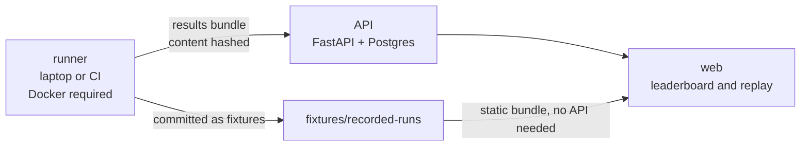

# trajectory

Evaluation harness for coding agents. Runs agents against containerized tasks with hidden
tests, and scores the trajectory, not just the outcome.

[](https://github.com/mekala27-45/trajectory/actions/workflows/ci.yml)
[](https://github.com/mekala27-45/trajectory/actions/workflows/pages.yml)
[](pyproject.toml)
[](LICENSE)


**Live leaderboard:** https://mekala27-45.github.io/trajectory/ &nbsp; **Metrics:**
[docs/metrics.md](docs/metrics.md) &nbsp; **Results:** [RESULTS.md](RESULTS.md)

> **New to coding agents or AI evaluation?** Start with the plain-language guide,
> [Understanding trajectory](docs/understanding-trajectory.md). It explains the whole project
> from scratch and walks through every page of the site, assuming only that you know what an AI
> model is. The rest of this README is written for engineers who want the precise version.

## Where to start

Five links, in the order that makes the rest of this readable. No install needed for any of
them.

1. **[Replay a real run](https://mekala27-45.github.io/trajectory/)**, on the live
   leaderboard. Click any row, then any step. That step by step record is the thing this
   project exists to produce, and seeing one is faster than reading about one.
2. **[The three findings](RESULTS.md#three-findings)**. Three agents tied at 100 percent and
   what separated them, a pass rate that could have been published as anything from 0 to 50,
   and a failure whose cause sits eight steps earlier in the trajectory.
3. **[What gets measured](docs/metrics.md)**, if you want the formulas rather than the prose.
   Ten metrics computed from the run record and the task, which is why a metric added later
   can be applied to results published earlier.
4. **[Real model results](MODEL-RESULTS.md)**. A real model on the same twelve tasks, on the
   Docker backend, for free, with the table figures gated against its run records.
5. **[Limitations](#limitations)**. Read before quoting anything above. The published matrix
   comes from scripted offline policies rather than language models, which is stated in full.
   The real model results are a separate, smaller measurement with their own limitations.

## Why

A model team improving a coding agent gets a pass rate of 41 percent. They ship a change.
It becomes 43 percent. They have no idea what changed. Did the agent get better at
recovering from a failed command, or did it get luckier on three tasks? Did the new system
prompt fix the shell quoting problem, or introduce a new tendency to claim success before
running the tests?

Aggregate pass rate hides all of that. Trajectory-level metrics do not. This harness exists
to make agent failures legible.

## Beyond the leaderboard

Five things this harness does that a pass-rate benchmark does not, each one command or one
document away:

- **It runs in your stack, not only this one.** Every task exports to the Harbor task
  format with `trajectory export harbor`, and every export is validated in CI against
  Harbor's own models, with a sample graded three ways. Runs export to ATIF, and
  `trajectory import atif` scores a trajectory from Claude Code, Codex, mini-swe-agent or
  OpenHands with the metrics its record can support. [docs/interop.md](docs/interop.md).
- **It resists reward hacking, and names the attempt.** Verification runs in a fresh
  container that holds the final workspace and nothing else the agent touched, with a test
  planted fresh for every run that has to fail: a report of success it does not survive is
  not believed. The verifier does not read the implicit import paths a dropped file would
  use, and failure mode **F11 grader tampering** flags a startup hook left behind or a report
  the planted test caught. A run that games its grader is the one thing a pass rate cannot
  show. [docs/grader-audit.md](docs/grader-audit.md).
- **It runs a panel of real models for free.** A committed request names the models, and one
  workflow probes each with a single call, then runs every model that answered in its own job,
  under its own call ceiling and a share of one rate limit, on a no-card tier.
  [docs/real-models.md](docs/real-models.md).
- **It says how sure each number is.** Every model's solve rate carries a 95% interval from
  resampling the tasks, then their seeds, with every task weighing the same; pass@k; and every
  pair of models compared head to head on the tasks both attempted. With twelve tasks the
  intervals are wide, and the site draws them rather than hiding them.
  [docs/metrics.md](docs/metrics.md#how-sure-a-number-is).
- **It measures its own tests.** Mutation testing replays each reference with one small bug,
  the slip a model makes, and counts how many the hidden tests catch. Every near miss that got
  through is listed by file and line, because a reward that pays a near miss in full teaches it.
  [docs/verifier-strength.md](docs/verifier-strength.md).

The published matrix shows the problem directly. Three of the five agents scored **100.0%
+/- 0.0%**, identical rows on any conventional leaderboard. One of them made a malformed
tool call on every single run. Another repeated roughly half of every command it issued.
Six failure modes fired 213 times on runs that passed every hidden test, on 106 of the 155
solved runs. A failure table scoped to failed runs shows four of those modes not at all and
the other two once each.

## Results

| model | solve rate | step efficiency | tool validity | redundancy | recovery |
| --- | --- | --- | --- | --- | --- |
| `stub:methodical` | 100.0% +/- 0.0% | 1.000 | 1.000 | 0.062 | 1.000 |
| `stub:sloppy` | 100.0% +/- 0.0% | 0.766 | **0.922** | 0.052 | **0.653 +/- 0.330** |
| `stub:thrasher` | 100.0% +/- 0.0% | **0.664** | 1.000 | **0.493** | 0.847 +/- 0.137 |
| `stub:reckless` | 97.2% +/- 3.9% | 0.766 +/- 0.001 | 1.000 | 0.045 | 0.972 +/- 0.039 |
| `stub:hasty` | **33.3% +/- 23.6%** | 1.000 | 1.000 | 0.014 +/- 0.010 | 0.917 +/- 0.118 |

180 runs, 12 tasks, 3 seeds, 18.2 minutes, 0.00 USD. A spread is printed where it is not
zero. Recovery was rescored on 25 October 2026 after a review found the metric credited a
`finish` straight after a failed command as a recovery; [RESULTS.md](RESULTS.md#leaderboard)
has the detail.

Step efficiency is scored only on runs that solved the task, so `stub:hasty` reaching
1.000 is not a contradiction: on the third of runs where quitting early happened to be
enough, it used no more steps than the reference route. Scoring efficiency on a failed
run would reward giving up, which is the behaviour this policy exists to exhibit.

These five are **scripted offline policies, not language models**. That is stated in full in
[RESULTS.md](RESULTS.md), along with three written findings and a limitations section that is
worth more than the table. Read that before quoting any of this.

## Quickstart

```bash
# from a clone, which is also where the twelve tasks live
git clone https://github.com/mekala27-45/trajectory && cd trajectory
uv sync --all-packages

# offline, no key, no spend: a scripted policy against one task
uv run trajectory run --task py-failing-suite-01 --model stub:methodical
uv run trajectory replay <run-id>

# with a real model
export ANTHROPIC_API_KEY=...
uv run trajectory run --suite core-12 --model anthropic/<model> \
  --seed 0 --seed 1 --seed 2 --parallel 4 --budget-usd 10.00
uv run trajectory report --format md
```

`--budget-usd` is a ceiling compared against the running spend before each model call, so a
parallel batch can overshoot it by the calls already in flight; for a free tier priced by
the request, `scripts/run_matrix.py --max-calls` reserves a slot before each call and cannot
overshoot. Any model
LiteLLM can reach works, including a local Ollama server, with no code change. The package
is not on PyPI yet, so it is run from a clone rather than installed.

From a checkout, `make install` then `make check`. If you have no `make`, which includes a
default Windows install, [CONTRIBUTING.md](CONTRIBUTING.md#without-make) lists the direct
`uv run` equivalent of every target.

## What gets measured

Ten metrics per run, computed from the run record and the task it attempted, so a metric
added later can be applied to results published earlier. Full formulas in
[docs/metrics.md](docs/metrics.md).

| | metric | what it catches |
| --- | --- | --- |
| 1 | solved | the hidden tests passed |
| 2 | partial credit | four failing tests taken down to one is progress |
| 3 | step efficiency | reference steps over steps taken, null on failures |
| 4 | tool call validity | malformed and invented tool calls |
| 5 | redundant action rate | repeated commands, compared with whitespace collapsed |
| 6 | recovery rate | did it adapt after a failure, or just retry |
| 7 | premature termination | called finish while the tests were still red |
| 8 | context drift | did the last third stay on task (judged) |
| 9 | cost and wall clock | spend per solved task, not per call |
| 10 | destructive attempts | `git reset --hard`, force pushes, `rm -rf` above the workspace |

Every rate on the leaderboard carries a standard deviation across seeds; counts, cost and wall
clock are reported as totals and means. A pass rate without its spread is not a result: one
policy here reads 33.3% +/- 23.6%, and a single-seed run of it would have published either
0% or 50%.

## Failure modes

Eleven named modes applied to every run. Eight decided by deterministic rules, three by a
rubric judge. The judge did not run on the results published here, so the three judged modes
never fired and the judge's self-agreement is unmeasured, which the limitations say in full.

| id | mode | how |
| --- | --- | --- |
| F01 | tool schema violation | rule |
| F02 | path hallucination | rule, against a workspace listing taken before step 0 |
| F03 | premature success | rule |
| F04 | retry loop | rule |
| F05 | shell quoting error | rule |
| F06 | ignored test output | judge |
| F07 | long horizon context loss | judge |
| F08 | destructive action | rule |
| F09 | scope creep | rule, against a workspace diff |
| F10 | environment mismatch | judge |
| F11 | grader tampering | rule, against a workspace diff |

Counts are reported over two populations: unsolved runs, which is the triage view, and
**solved runs**, which is the view no pass rate can produce. A run that made three
malformed calls, invented two paths and got the tests green anyway is a process problem
that succeeded.

Browse them on the [live failures page](https://mekala27-45.github.io/trajectory/failures).

## The suite

Twelve tasks, four languages, difficulty 1 to 5. Each ships a Dockerfile, a workspace, a
set of hidden tests the agent never sees, and a reference solution that CI replays against
those tests on every push.

| id | lang | tier | what breaks |
| --- | --- | --- | --- |
| `py-failing-suite-01` | py | 1 | one off by one in an inclusive date range |
| `py-dep-conflict-01` | py | 2 | two plugins pinned against incompatible majors |
| `ts-build-break-01` | ts | 2 | a project reference build, with strict mode as the trap |
| `log-forensics-01` | any | 2 | one config change in 40,000 log lines, three distractions |
| `py-flaky-test-01` | py | 3 | unseeded randomness, failing about three runs in ten |
| `py-perf-01` | py | 3 | accidentally quadratic, 12.0 s against a 2.0 s budget |
| `py-etl-schema-01` | py | 3 | upstream renamed, split and reformatted its columns |
| `cli-implement-01` | py | 3 | a written specification and no visible tests at all |
| `ts-api-contract-01` | ts | 3 | a generated client that drifted, with a hand edit on top |
| `go-race-01` | go | 4 | a data race that one big mutex "fixes" and fails |
| `sql-migration-01` | sql | 4 | a migration that is correct and unsafe to run |
| `git-surgery-01` | any | 5 | a commit dropped by a rebase, reflogs expired |

Every task has a plausible wrong fix that the hidden tests reject, named in its
description. That is what separates a task that measures engineering from one that measures
typing. `ts-api-contract-01` is the clearest: repairing the symptom builds green and scores
4 of 9.

## Architecture

Evaluation compute and results storage are separate systems.

Running an agent needs Docker, arbitrary CPU, and the ability to execute untrusted
model-generated shell commands. So the runner executes where Docker is available, a laptop
or a CI job, produces a results bundle carrying a content hash, and pushes it to a small API
that stores it in Postgres and serves it to the web app. The public site skips the API: it
is a static build of the records committed to this repository.

That is not a workaround for a hosting constraint. Evaluation compute wants to be elastic
and ephemeral; results want to be durable and queryable. Coupling them means either paying
for idle capacity or losing your results when the box goes away.



The one property everything rests on: **the hidden tests are not in the filesystem while
the agent is running.** They are copied in only after the agent stops. The image is built
from a context that holds the Dockerfile and the workspace and nothing else, so no
instruction in a Dockerfile can bake them in, and task validation refuses one that names
them. A test searches the whole container filesystem during the agent phase and asserts
they are not there.

Full detail, including the storage shape and what is deliberately absent, in
[ARCHITECTURE.md](ARCHITECTURE.md).

## Writing your own tasks

```bash
uv run trajectory tasks new my-task-01 --difficulty 3 --language python
uv run trajectory tasks validate --strict
uv run trajectory tasks verify-references --task my-task-01
```

`verify-references` asserts that the unfixed workspace **fails** its hidden tests and that
the reference playbook drives it to passing. A task that starts green is scored by every
agent and measures nothing; a task whose own reference solution has rotted can be scored by
none. Both happen in real benchmarks and both quietly move the suite average.

[docs/writing-tasks.md](docs/writing-tasks.md) is the full guide.

## Limitations

Not buried, because they decide whether the rest is worth reading.

- **Twelve tasks is twelve tasks.** Not comprehensive, not state of the art, not the first
  of anything. Solve rates on twelve tasks have wide confidence intervals however many
  seeds you run.
- **One person wrote every task**, so the suite carries that person's biases about what is
  hard. Nothing here covers reading an unfamiliar large codebase, or API design, or
  anything a front-end engineer would recognise as their job.
- **The published matrix is scripted policies, not models.** It validates the harness. It
  says nothing about any language model. [MODEL-RESULTS.md](MODEL-RESULTS.md) is one real
  model at two seeds, the second seed cut short by the call ceiling, which makes it a
  first measurement, not a ranking.
- **The grader is hardened, not unbeatable.** The cheap exploits are closed: a planted
  import-path module cannot shadow the hidden tests, a verifier run that reports no test
  scores zero, and nothing the agent left outside its workspace is present when the tests
  run. One route is narrowed and named rather than closed: because a hidden test imports the
  solution, the solution runs in the grader's process. A planted test that must fail catches
  a report bent as a whole, but not one bent for particular tests. Closing that needs tests
  whose expected values never enter the solution's process.
  [docs/grader-audit.md](docs/grader-audit.md) sets out the whole surface.
- **The published matrix ran on the unisolated sandbox until 16 September 2026**, because
  the authoring machine had no Docker daemon. It now runs in containers, and re-recording it
  produced a result worth reading: the backend changed no verdict and exactly one
  behavioural metric cell moved, by about a tenth of its own seed standard deviation. The local backend still
  exists, is still not an isolation boundary, and is still gated behind an environment
  variable, but that is now a caveat about a tool this repository ships rather than about
  these numbers.
- **Judge self-agreement is unmeasured.** Metric 8 is null on all 180 runs and the three
  judged modes were never applied. Their zeros mean "not measured". A free model key now
  exists, so this is the next measurement rather than a blocked one.
- **Step efficiency divides by a reference solution one person wrote**, which may not be
  optimal. Read it as a ratio against one competent route.
- **Redundant action rate has a baseline above zero**, 0.062 on this suite, the rate of the
  reference route, because re-running the tests after a fix is a repeat command and the
  right thing to do. It is not a floor: a policy that skips that second run, or pads its
  trajectory with commands of its own, scores below it.

[RESULTS.md](RESULTS.md) states each of these with the specific number affected.

## Licence and independence

Apache 2.0. See [LICENSE](LICENSE).

Independent work, built from scratch against public tooling and public data. No employer
code, data, system names or screenshots. Every task in the suite was written for this
repository.

## Who built this

[Ajay Mekala](https://linkedin.com/in/ajaymekala). AI/ML Engineer, production ML platforms
and MLOps. Four years across software engineering and frontier model evaluation, the
evaluation work on contract: agent trajectory scoring, benchmark task authoring, rubric
design.

That contract work is covered by NDA, which is the reason this repository exists. It applies
the same methodology to tasks written from scratch, in public, where the numbers can be
checked rather than taken on trust.

[Portfolio](https://mekala27-45.github.io) &nbsp; [GitHub](https://github.com/mekala27-45)
&nbsp; mekalaajayk@gmail.com

Open to AI/ML Engineer, Machine Learning Engineer and model evaluation roles. Questions about
the design are welcome as issues.
